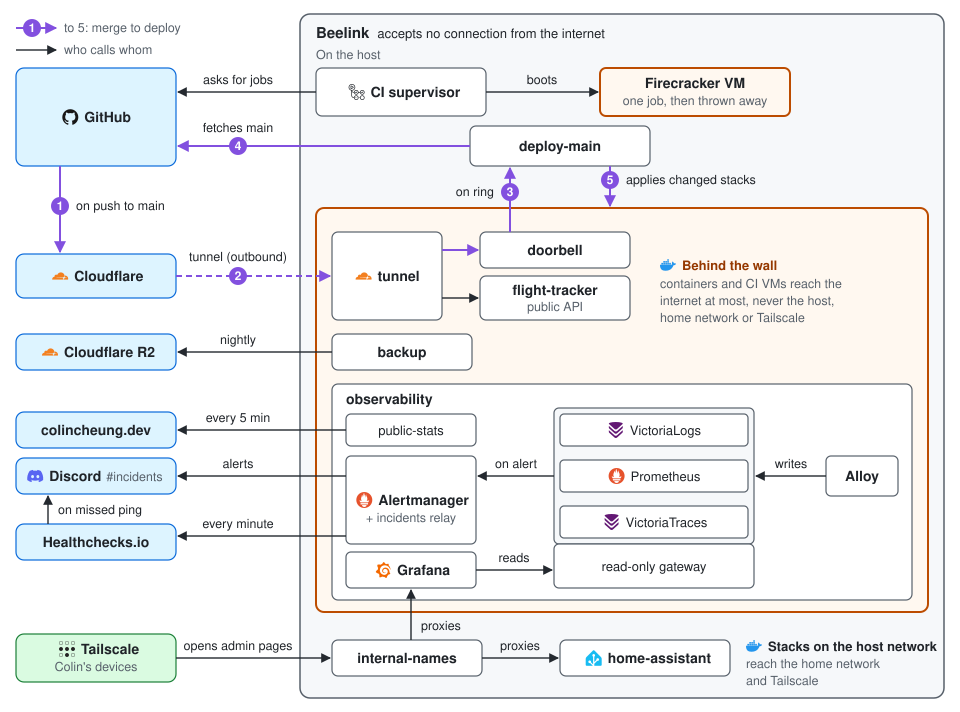

# Homelab

One Beelink mini-PC running Docker Compose stacks: Home Assistant, the
[flight tracker](https://github.com/ColinCee/flight-tracker-at-home) backend, monitoring with alerts to Discord,
nightly encrypted backups to Cloudflare R2, and Colin's CI in Firecracker VMs. Nothing accepts a
connection from the internet: admin access is over Tailscale, and the flight tracker's API leaves through Cloudflare
Tunnel.

[](https://github.com/ColinCee/homelab/actions/workflows/ci.yaml?query=branch%3Amain)
[](https://github.com/ColinCee/homelab/actions/workflows/deploy.yaml?query=branch%3Amain)



A merge to `main` deploys. Check a change first:

```bash
mise run check
```

- [Architecture](docs/architecture.md): how the parts connect, deploys, access, CI, alerts, backups.
- [Recovery](docs/recovery.md): restoring from backup and rebuilding the host.
- [Decisions](docs/adr/): comparisons that were run.

The repository alone does not prove the live security posture: firewall rules, Tailscale's policy and running
services are checked on the host (`scripts/security-audit.sh`).
