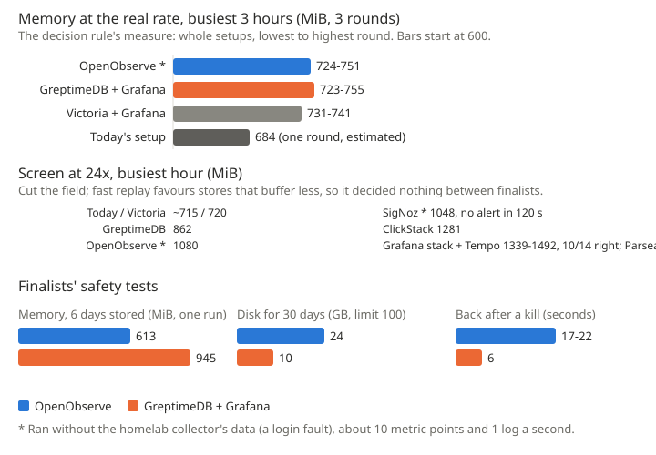

# 0001 evidence: the observability bake-off

The method and results behind [0001](../0001-openobserve.md).

## Must-haves

| Must-have | Result |
|---|---|
| Every record kept, 14 of 14 answers right | Shown for both finalists |
| Alert within 120 s | Shown for a log alert only. The metric-threshold and stopped-reporting alerts are not yet shown |
| Back within 5 minutes of a kill, at most 60 s lost | Shown |
| 30 days in 100 GB | Shown |
| Old data deleted | Started in both, but not shown finishing: OpenObserve stopped part-way |
| Dashboards rebuilt | Not yet done |
| Logins | On for every setup; not checked port by port |

## How it was measured

- Data: one real day of the homelab and Kaizen (spans, logs, metric points), replayed with fresh timestamps. A shared collector added the test box's own host metrics and container logs.
- Answer key: 14 questions the owner actually asks of it, answered from the raw day, never by a candidate.
- Fairness: each setup ran whole, tuned by its makers' small-host advice, in its own 2.5 GiB container on the desktop, side by side. Memory is what the programs hold, with the disk cache left out.
- Stages, each cutting candidates:
  1. a 24x screen;
  2. 4x;
  3. 3 rounds of the busiest 3 hours at the real rate;
  4. safety tests on the two finalists: 6 days bulk-loaded, every container killed, the shortest keep period.
- Gap: in every real-rate round, OpenObserve's collector had the wrong login, so it missed the homelab load (about 10 points and 1 log a second). The login is fixed, but those rounds were not rerun.

## Results

| | OpenObserve | GreptimeDB + Grafana |
|---|---|---|
| Memory at the real rate, 3 rounds | 724-751 MiB | 723-755 MiB |
| Memory, 6 days stored, quiet (one run, no collector) | 613 MiB | 945 MiB |
| Peak memory loading 6 days fast | 1548 MiB | 1324 MiB |
| Disk for 30 days | ~24 GB | ~10 GB |
| Back after a kill | 16.5-21.7 s | 5.7 s |
| Data lost in a kill | 15-18 spans and 20-43 logs at default settings; none with the write settings below | none |
| Old data deleted | hours late, stopped part-way once | hours late, in whole files only |

Today's setup measured 684 MiB at the real rate. That is one round, estimated as the box's peak minus Tempo's, which today's setup does not run.

Out at earlier stages:

- Grafana stack: 10 of 14 answers; Tempo alone used 617-783 MiB and once ran out of memory at 1797 MiB.
- Parseable: 2379 MiB.
- ClickStack: 1249-1305 MiB.
- SigNoz: first alert after 222 s. Its collector also delivered nothing.

VictoriaMetrics + Grafana was a finalist at the real rate (731-741 MiB). It lost on simplicity: three stores plus Grafana.

## Crash loss

At default settings OpenObserve confirms a write before it saves it to disk, so a kill loses the last few seconds. Both kill runs at default settings lost data.

With `ZO_WAL_WRITE_QUEUE_ENABLED=false` and `ZO_WAL_FSYNC_DISABLED=false`, one run lost no spans or logs, and 68 metric points. During the 22 s restart the test sender gave up on one batch; a real collector would retry it. These settings ship. Their memory and speed are checked in the move's first step.

## What would change it

- Disk: if disk mattered beyond fitting in 100 GB, GreptimeDB + Grafana (2.3 times less).
- Alerts: if OpenObserve can't carry today's 27 rules. Six of them combine several queries, five alert on missing data, and all of them send recovery messages and alert on evaluation errors. Its docs leave each of these unclear, so the move's first step proves them. A Grafana-based fallback keeps the rules almost unchanged.
- Memory: if OpenObserve with the homelab load runs well above the 724-751 MiB it measured without it.
- Expiry: if old data still isn't deleted after a real month.
- Release: if the stable release behaves unlike v1.2.0-rc1, the version tested.

The raw results and the test harness are kept privately.
