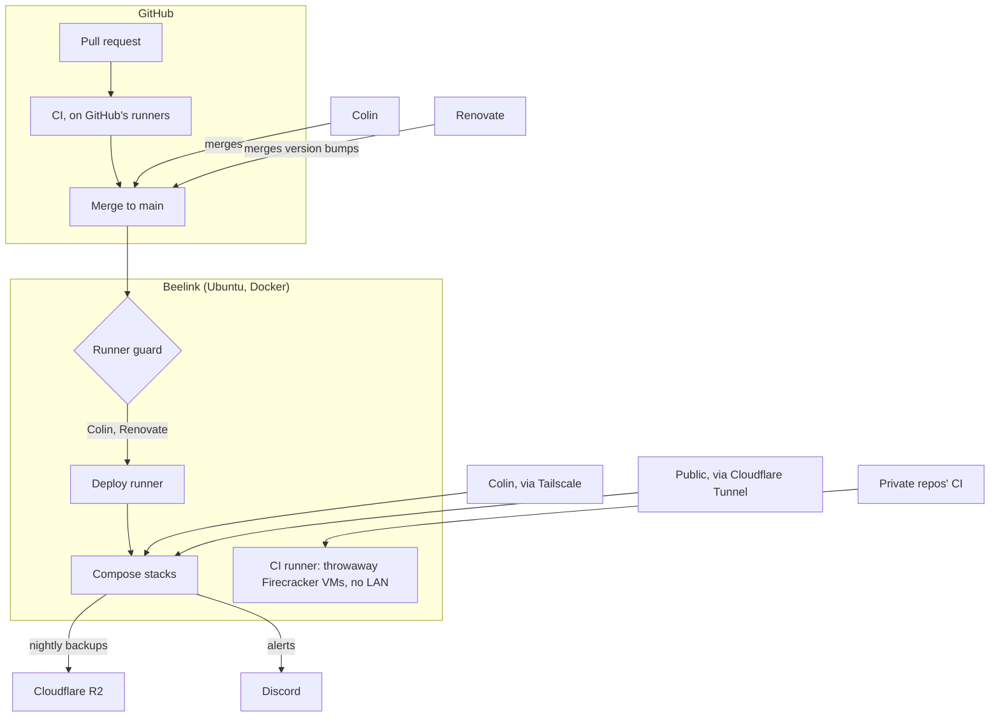

# Architecture

How changes reach the Beelink, and who can reach what runs on it.

- **Merging is deploying.** A merge to `main` runs [`deploy.yaml`](../.github/workflows/deploy.yaml) on the deploy runner, which renders each stack's `.env` from GitHub secrets and applies the stacks the change touched (all of them when shared deploy files changed). The [runner guard](../scripts/runner_job_guard.py) kills any job not started by Colin or Renovate.
- **Two runners on one host.** The deploy runner holds the secrets and drives Docker, so only this repo's deploys run there. The [CI runner](runbooks/ci-runner.md) runs other private repos' CI in throwaway VMs that reach the internet but not the home network.
- **Alerts go to Colin in Discord**, each saying why it matters and what to do. See [observability](observability.md#alerts).
- **Access.** Admin pages bind to the Tailscale address; only the flight tracker's API is public, through Cloudflare Tunnel. Containers on Docker networks reach the internet and each other, not the host, LAN or tailnet ([ADR 0005](adr/0005-container-network-wall.md)).
