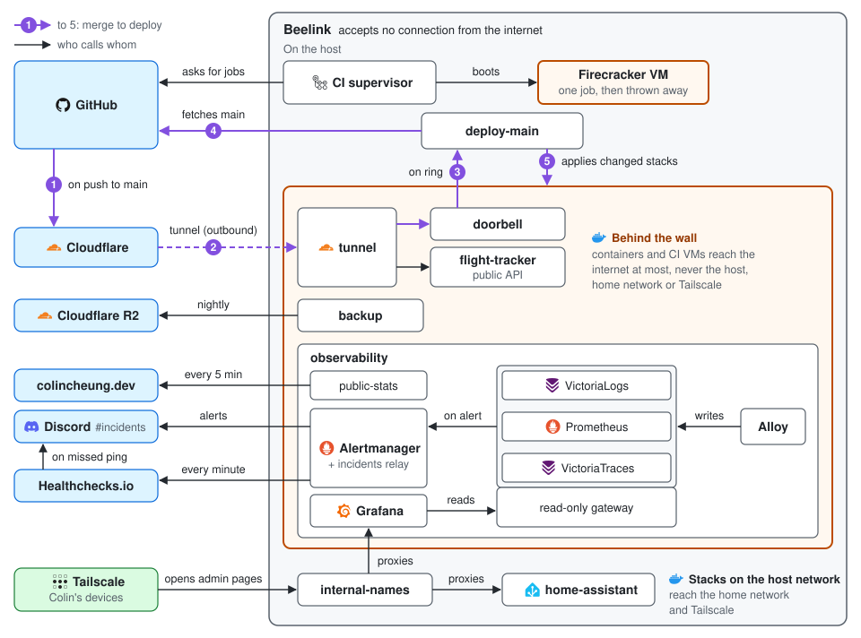

# Architecture

How the Beelink's parts connect: the one home for what the code does not say. Code comments point to these
sections; hand steps after a failure are in [recovery](recovery.md).

## Deploys

- **Merging is deploying.** GitHub's push webhook (no secret, set by hand) rings the
  [doorbell](../stacks/deploy/doorbell.py) through the tunnel.
  [`deploy-main`](../stacks/deploy/deploy_main.py), on each ring and every 15 minutes, fetches `main`, refuses one
  that dropped the deployed commit, and runs [`deploy.sh`](../scripts/deploy.sh) for stacks changed since the last
  full deploy ([`deploy.py`](../scripts/deploy.py)) or reading a changed secret, until `main` stops moving. A forged
  ring deploys nothing new. No code from GitHub runs on the Beelink to deploy.
- **Who may deploy.** Whoever lands a commit on `main`, which takes a pull request with checks green, admins included.
- **A stack** is `stacks/<name>/compose.yaml`, found by the deploy with no registry:
  - images pinned, `restart: unless-stopped`, admin ports bound to the Tailscale address, host networking only when
    the service needs it;
  - `labels: {homelab.config-hash: ${CONFIG_HASH_<SERVICE>:-}}` on a service that reads a mounted file without reloading,
    and `init: true` when its main process ignores SIGTERM as PID 1;
  - each secret a Compose `secrets:` file from `../../secrets/` (its one copy elsewhere is in Bitwarden), never in
    `environment:`, which `docker inspect` shows;
  - `systemd/<stack>-*.service` with a `.timer` or `.path` install as user units (the host has linger on) and write
    `*.prom` files to `/var/lib/homelab-metrics` for Alloy;
  - another stack's network is joined as `external: true`.
- **Removing a stack:** deleting its folder removes nothing from the host. Stop its timers and containers by hand,
  keep volumes until their data is backed up or retired, then delete the folder and
  `/var/lib/homelab-metrics/deploy-<stack>.prom`.

## Network and access

- Nothing accepts an internet connection. Admin pages bind to the Tailscale address, which Docker waits for
  at boot ([`tailscale.conf`](../systemd/docker.service.d/tailscale.conf)). Who may reach what is the tailnet policy
  ([`tailscale_policy.py`](../scripts/tailscale_policy.py)); addresses and `.internal` names are in the
  reaching-homelab-devices skill.
- Public only through the [tunnel](../stacks/tunnel/compose.yaml), an outbound connection: routes set in Cloudflare's
  dashboard take `api.colincheung.dev` to `backend:8000` and `deploy.colincheung.dev/ring` to `doorbell:8080` on the
  `tunnel` network, which has no way out. Filtering belongs at Cloudflare.
- Docker's bridge containers and the CI VMs reach the internet, not the host, LAN or tailnet: two nftables tables in
  [`homelab-ci.nft`](../ci-runner/net/homelab-ci.nft). A service that needs
  the host uses host networking, as Home Assistant, the probes and `internal-names` do.

## CI runner

CI for Colin's own jobs, each in its own Firecracker VM, thrown away after one job. Why Firecracker,
and how fast: [ADR 0002](adr/0002-ci-runner.md).

| `runs-on` | VM |
|---|---|
| `[self-hosted, linux, x64, homelab-fc]` | Its size by load ([`ci_supervisor.py`](../scripts/ci_supervisor.py), `vm_size`); the repo's cache disk |
| add `fc-cache-<owner>--<name>` | Another served repo's cache disk |

- The image carries the usual tools ([`rootfs/`](../ci-runner/rootfs/), versions in
  [`versions.env`](../ci-runner/versions.env)), so a job needs no setup actions. Each VM gets its repo's cache disk
  at `/cache`, from the last green push to the default branch; a job saves it with
  [`fc-cache`](../.github/actions/fc-cache/action.yml) as its last step. Do not also restore GitHub's caches.
- Served, with no other writer: private repos the token sees, and `PUBLIC_REPOS`
  ([`ci_supervisor.py`](../scripts/ci_supervisor.py)) while GitHub holds outside contributors' runs for approval. A
  runner takes any queued job of its repo, so the VMs' guard ([`runner_job_guard.py`](../scripts/runner_job_guard.py))
  kills a public repo's job unless Colin started it from the repo.
- The home's services come first: a VM starts only while it leaves the memory reserve and the disk is not busy, and
  VMs run at CPU weight 20 against the services' 100. How long runs take: [`ci_times.py`](../scripts/ci_times.py) traces each run and alerts
  when main slows.
- Changes go in by merging: `homelab-ci-update.timer` installs main within minutes; running jobs carry on
  ([`update.py`](../ci-runner/update.py)). Slots, standby VMs and the memory reserve live in `/etc/homelab-ci/`; slots change only through `SLOTS=<n> install-host.sh`, after which
  the host load-tests the count. Run any wait on the Beelink as a named systemd unit, never a loop on your own SSH
  connection.
- Host units run `homelab-python3`, the `mise.toml` Python, which `install_host.py` links after a hash check. It and
  `update.py` stay on the system's 3.12 to repair it, as do the deploy scripts, which need its `python3-yaml`.
- [`audit.sh`](../ci-runner/tests/audit.sh) gates every Firecracker, kernel or runner upgrade.

## Monitoring and alerts

Alloy collects metrics into Prometheus, and logs and [OBI's](../stacks/observability/obi/obi.yaml) container traces into
VictoriaLogs and VictoriaTraces, 30 days each;
Grafana shows them at `http://grafana.internal` ([ADR 0001](adr/0001-observability-stack.md)). Readers reach the
stores only through the read-only gateway ([`Caddyfile`](../stacks/observability/gateway/Caddyfile), port 5081),
agents as `agents`. Dashboards come from Git: the building-dashboards skill.

| Problem | Who warns |
|---|---|
| The Beelink off, or alerting stopped | The always-firing `watchdog` rule, which Alertmanager sends to Healthchecks.io each minute; Healthchecks.io emails and posts when it stops |
| A rule failing | "An alert rule is failing" |
| Someone else on the Beelink | The `intrusion` rules, over what [`security_facts.py`](../scripts/security_facts.py) writes each minute |
| A deploy failed | "Main not deployed" |

**The alert standard.** An alert exists only if something is harmed now or soon, Colin can act on it, and the post
says what to do; anything else is a dashboard number. A post breaking it is a bug: fix the cause, then delete it and
its "Cleared". [Rules](../stacks/observability/prometheus/rules.yml) post through
[Alertmanager](../stacks/observability/alertmanager/alertmanager.yml) to Discord's #uptime. Alertmanager has no port
(its API takes silences without a login): `docker exec observability-alertmanager-1 amtool alert query
--alertmanager.url=http://localhost:9093`.

| Level | When | Post |
|---|---|---|
| `now` | A service is down, data is being lost, or something is full within 24 h | Mentions Colin, again every 4 h |
| `week` | Something is running out or slipping | No mention, again daily |

- A rule fires after its `for` and clears after 10 minutes clear; a return inside them is the same alert. "Cleared"
  means the number recovered.
- "Beelink metrics stopped" holds back every alert that reads Alloy's metrics; only textfile metrics carry a no-data
  arm, except a job's that may not have run yet.
- Noise budget: at most one post a day over 14 days. Before adding or loosening a rule, replay it:
  `GATEWAY_LOGIN=agents@homelab.internal:<password> uv run python stacks/observability/prometheus/replay.py 14`.
  Test rules with promtool (`tests/test_alert_rules.py`), never with fake events on the Beelink.

Traps:

- Host metrics carry `job="integrations/unix"` and include the CI VMs; the VMs' own CPU and memory are
  `job="ci-vms"`, present only while a slot runs a VM.
- Caddy, CoreDNS and Home Assistant serve metrics only on loopback: `host-metrics` scrapes them from the host network,
  Home Assistant once it has `prometheus:` and `HOMEASSISTANT_METRICS_TOKEN` secret;
  [`probes.py`](../stacks/observability/probes.py) checks them for the alerts. The flight tracker's `probe_success` is 1
  only when its public API says its data is live; the public sites' (`job="integrations/blackbox/sites"`) only on a
  200.
- `loki.secretfilter` in [`config.alloy`](../stacks/observability/config.alloy) redacts the secrets it recognises;
  one in another form still reaches the log store.

## Backups

[restic](../stacks/backup/backup.py) runs nightly at 02:30 UTC into the Cloudflare R2 bucket `beelink-backups`,
encrypted: Home Assistant's config and a consistent copy of its history, the flight tracker's heatmap volume, and
`~/pc-backups`, which PC projects fill by listing their data in a `backup.toml`
([`pc_backup.py`](../scripts/pc_backup.py)). Everything else is in Git or disposable. It keeps 7 daily, 4 weekly and
6 monthly snapshots, reads back every byte on Sundays, and uploads nothing past 8 GB, since R2 bills past 10 GB.
`RESTIC_PASSWORD` is also in Bitwarden: without it nothing decrypts. A monthly upkeep test-restores a file. Restoring: [recovery](recovery.md).

## Public stats

The `public-stats` container pushes a few numbers every 5 minutes, signed with an Ed25519 key, to the blog's
Worker at colincheung.dev/homelab.json, which the home page shows. They are coarse on purpose, since anyone can poll
and keep a history: the fields and why are in [`public_stats.py`](../stacks/observability/public_stats.py), the key
and its rotation in [`public_stats_key.py`](../scripts/public_stats_key.py).
