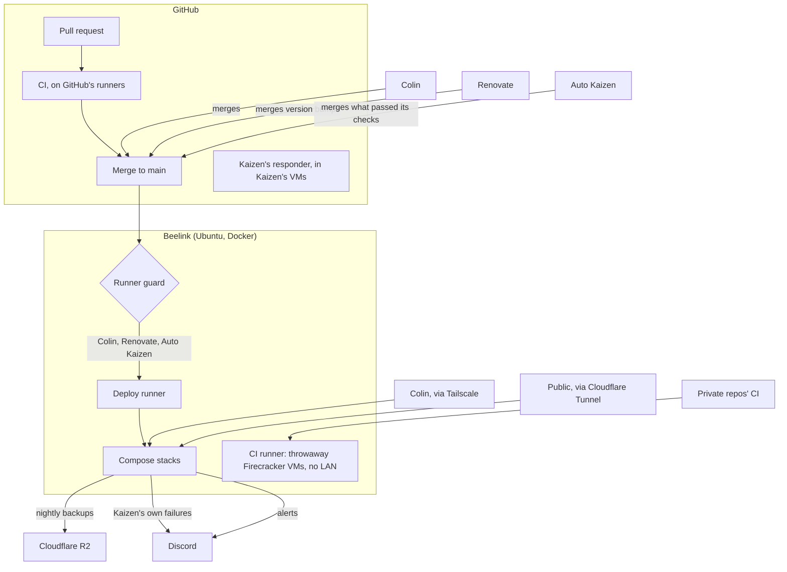

# Architecture

How changes reach the Beelink, and who can reach what runs on it. Auto Kaizen, the factory that makes many of these changes, has its own: [auto-kaizen architecture](https://github.com/ColinCee/auto-kaizen/blob/main/docs/architecture.md).

- **Merging is deploying.** A merge to `main` runs [`deploy.yaml`](../.github/workflows/deploy.yaml) on the deploy runner, which renders each stack's `.env` from GitHub secrets and applies the stacks the change touched (all of them when shared deploy files changed). The [runner guard](../scripts/runner_job_guard.py) kills any job not started by Colin, Renovate or Auto Kaizen.
- **Two runners on one host.** The deploy runner holds the secrets and drives Docker, so only this repo's deploys run there. The [CI runner](runbooks/ci-runner.md) runs other private repos' CI in throwaway VMs that reach the internet but not the home network.
- **Auto Kaizen** merges only changes that pass CI, its reviewer and its red-line checks; changes to `scripts/`, `ci-runner/` and `.github/` that widen access (a new secret for a stack or job, host or root access, a loosened runner guard), compose options that give a container power over the host, and a stack's `.env.example` asking for a deploy secret, wait for Colin; other edits there merge like any change. A failed or blocked deploy stops its work until fixed.
- **Alerts go to Colin in Discord**, each saying why it matters and what to do. See [observability](observability.md#alerts).
- **Access.** Admin pages bind to the Tailscale address; only the flight tracker's API is public, through Cloudflare Tunnel.
